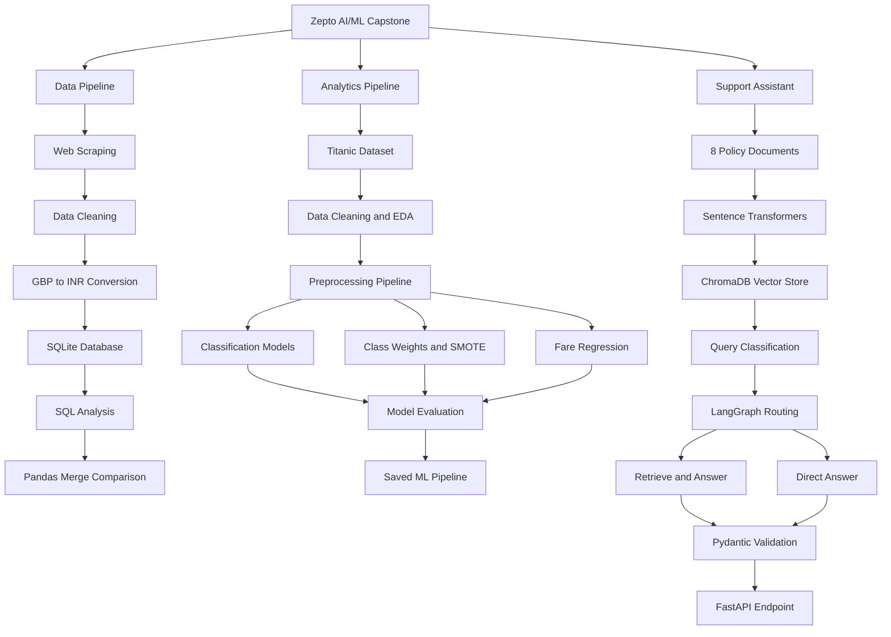

# Zepto AI/ML Capstone

This project brings together three connected parts of an AI/ML capstone:

1. **Data Pipeline:** Web scraping, data cleaning, currency conversion, SQLite storage, and SQL analysis.
2. **Analytics Pipeline:** Titanic data cleaning, EDA, visualization, classification, imbalance handling, and regression.
3. **Support Assistant:** A local RAG-based Zepto policy assistant using embeddings, ChromaDB, LangGraph, Pydantic, and FastAPI.

---

## System Architecture



---

## Setup

Install the required dependencies for each module:

```bash
pip install requests beautifulsoup4 pandas
pip install numpy seaborn matplotlib scikit-learn imbalanced-learn joblib
pip install fastapi uvicorn langgraph langchain-core chromadb sentence-transformers pydantic
```

Python 3.11+ is recommended.

The Data Pipeline requires internet access for the BooksToScrape website. The Support Assistant uses the local Sentence Transformer embedding model.

---

## Module 1: Data Pipeline

The Data Pipeline module scrapes book data from BooksToScrape, cleans the data, converts GBP prices to INR, stores the processed data in SQLite, and performs SQL analysis.

### Run from the project directory

```bash
cd data_pipeline
python scrape.py
python clean_and_load.py
python load_db.py
python queries.py
python task6_compare.py
```

### Pipeline Workflow

- Scrapes book data from BooksToScrape
- Cleans price, rating, and availability fields
- Converts GBP prices to INR
- Uses a fixed conversion rate of 1 GBP = 105.50 INR
- Creates a SQLite database
- Creates related database tables
- Runs SQL analysis
- Compares SQL JOIN results with Pandas merge results

### Data Cleaning

- Removes the pound symbol from prices
- Converts prices to numeric values
- Maps star ratings such as `Three` to `3`
- Converts availability into a boolean value
- Drops rows with missing title or category
- Replaces numeric parsing failures with the median

### Technologies

- Python
- Requests
- BeautifulSoup
- Pandas
- SQLite

---

## Module 2: Analytics Pipeline

The Analytics Pipeline uses the Titanic dataset for data cleaning, exploratory data analysis, visualization, classification, imbalance handling, and regression.

The dataset is loaded once and saved locally as `titanic.csv`. Later processing uses the saved dataset.

### Run from the project directory

```bash
cd analytics
python 01_eda.py
python 02_modeling.py
```

### Analytics Workflow

- Loads and cleans the Titanic dataset
- Measures missing values
- Handles missing data
- Performs univariate analysis
- Performs bivariate analysis
- Detects outliers using IQR
- Creates correlation analysis
- Generates visualization charts
- Performs stratified train-test splitting
- Builds preprocessing pipelines
- Trains classification models
- Handles class imbalance
- Performs fare regression
- Evaluates model performance
- Saves the final ML pipeline

### Classification Models

- Logistic Regression
- Decision Tree
- Random Forest

### Imbalance Handling

The project compares:

- Baseline model
- `class_weight="balanced"`
- SMOTE

SMOTE is applied only to the training data.

### Regression

Linear Regression is used to predict fare.

A residual plot is generated to analyze regression errors and identify heteroscedasticity.

### Saved Artifact

```text
final_pipeline.joblib
```

The saved artifact contains the preprocessing `ColumnTransformer` and the final estimator.

### Technologies

- Python
- Pandas
- NumPy
- Seaborn
- Matplotlib
- Scikit-learn
- Imbalanced-learn
- Joblib

---

## Module 3: Support Assistant

The Support Assistant is a local RAG-based Zepto policy assistant.

It loads eight policy documents, creates embeddings using Sentence Transformers, stores them in ChromaDB, retrieves relevant documents, routes queries using LangGraph, validates responses using Pydantic, and exposes the system through FastAPI.

### Run from the project directory

```bash
cd support_assistant
python -m uvicorn main:app --host 127.0.0.1 --port 8000
```

### API Endpoint

```text
http://127.0.0.1:8000/ask
```

### Assistant Workflow

- Loads 8 policy documents
- Creates embeddings using `all-MiniLM-L6-v2`
- Stores embeddings in ChromaDB
- Retrieves the top 3 relevant chunks
- Classifies the user query
- Routes the query through LangGraph
- Generates an answer from retrieved context
- Validates the response with Pydantic
- Returns structured JSON through FastAPI

### LangGraph Flow

```text
START
  |
  v
classify_intent
  |
  +------ policy_question ------> retrieve_and_answer
  |
  +------ general_question -----> direct_answer
```

### Pydantic Response

Every response contains:

```json
{
  "answer": "...",
  "sources": ["doc_01"],
  "confidence": 1.0
}
```

### Example Request

```json
{
  "query": "What is the delivery policy?"
}
```

### MOCK_LLM

The application runs in mock mode by default:

```python
MOCK_LLM = os.environ.get("MOCK_LLM", "1") == "1"
```

Mock mode allows the complete retrieval pipeline to run without an external LLM API key.

The optional real-LLM mode changes only the generation stage. Document ingestion, embeddings, retrieval, and routing still run locally.

### Technologies

- Python
- Sentence Transformers
- ChromaDB
- LangGraph
- LangChain Core
- Pydantic
- FastAPI
- Docker

---

## Docker

A Dockerfile is included for the Support Assistant.

### Build

```bash
cd support_assistant
docker build -t zepto-support-assistant .
```

### Run

```bash
docker run -p 7860:7860 zepto-support-assistant
```

The container exposes the Support Assistant on port `7860`.

---

## Design Decisions

### Data Pipeline

Requests and BeautifulSoup are used for web scraping, Pandas handles cleaning and transformation, and SQLite provides local relational storage.

The currency conversion uses a fixed project constant:

```text
1 GBP = 105.50 INR
```

No external currency API or date-based exchange rate is used.

### Analytics

The Titanic workflow keeps preprocessing inside a Scikit-learn `Pipeline` and `ColumnTransformer` so transformations are fitted only on the training data.

Class imbalance is evaluated using class weights and SMOTE.

### Support Assistant

The Support Assistant keeps documents, embeddings, and vector retrieval local.

Sentence Transformers provides embeddings, ChromaDB provides semantic retrieval, and LangGraph manages query routing.

Pydantic provides structured output validation, and FastAPI exposes the service through an API endpoint.

---

## Verification

### Module 1: Data Pipeline

Run:

```bash
cd data_pipeline
python scrape.py
python clean_and_load.py
python load_db.py
python queries.py
python task6_compare.py
```

The SQL JOIN result and Pandas merge result are compared to verify that both approaches produce equivalent output.

### Module 2: Analytics

Run:

```bash
cd analytics
python 01_eda.py
python 02_modeling.py
```

The scripts generate the cleaned dataset, EDA charts, model evaluation results, regression analysis, and saved pipeline.

### Module 3: Support Assistant

Run:

```bash
cd support_assistant
python -m uvicorn main:app --host 127.0.0.1 --port 8000
```

Test the API using:

```text
http://127.0.0.1:8000/docs
```

---

## Project Technologies

| Area | Technologies |
|---|---|
| Data Pipeline | Python, Requests, BeautifulSoup, Pandas, SQLite |
| Analytics | Pandas, NumPy, Seaborn, Matplotlib |
| Machine Learning | Scikit-learn, Imbalanced-learn, Joblib |
| RAG | Sentence Transformers, ChromaDB |
| Orchestration | LangGraph |
| API | FastAPI, Uvicorn |
| Validation | Pydantic |
| Deployment | Docker |

---

## Requirement Checklist

| Requirement | Status | Module |
|---|---|---|
| Web scraping | Complete | Data Pipeline |
| Data cleaning | Complete | Data Pipeline |
| Currency conversion | Complete | Data Pipeline |
| SQLite database | Complete | Data Pipeline |
| SQL analysis | Complete | Data Pipeline |
| Pandas SQL JOIN comparison | Complete | Data Pipeline |
| Titanic EDA | Complete | Analytics |
| Missing-value handling | Complete | Analytics |
| Classification models | Complete | Analytics |
| Class imbalance handling | Complete | Analytics |
| Fare regression | Complete | Analytics |
| Saved ML pipeline | Complete | Analytics |
| Policy documents | Complete | Support Assistant |
| Embeddings | Complete | Support Assistant |
| ChromaDB retrieval | Complete | Support Assistant |
| LangGraph routing | Complete | Support Assistant |
| Pydantic output | Complete | Support Assistant |
| FastAPI endpoint | Complete | Support Assistant |
| Dockerfile | Complete | Support Assistant |

---

## Conclusion

This capstone demonstrates an end-to-end workflow across **data engineering, analytics, machine learning, and AI application development**.

The three modules cover the progression from **data collection and SQL processing**, to **machine learning**, and finally to a **local RAG-based AI support system exposed through an API**.
